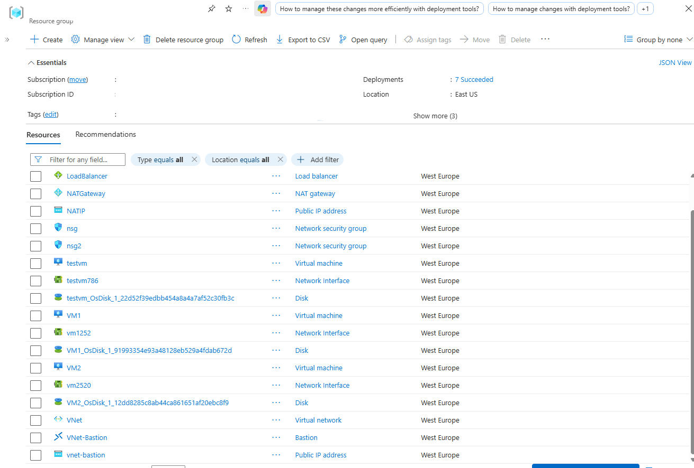
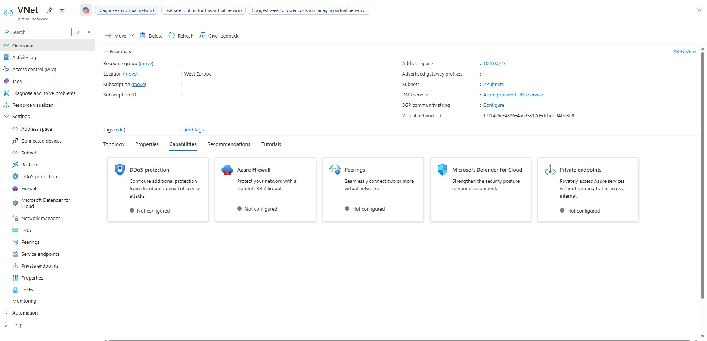
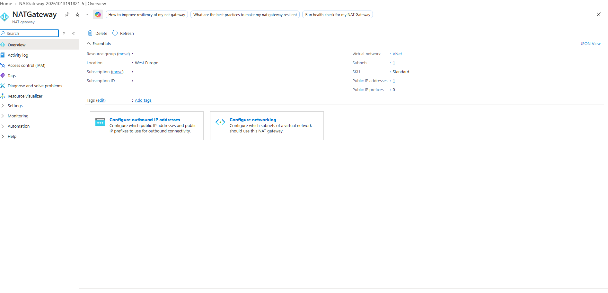
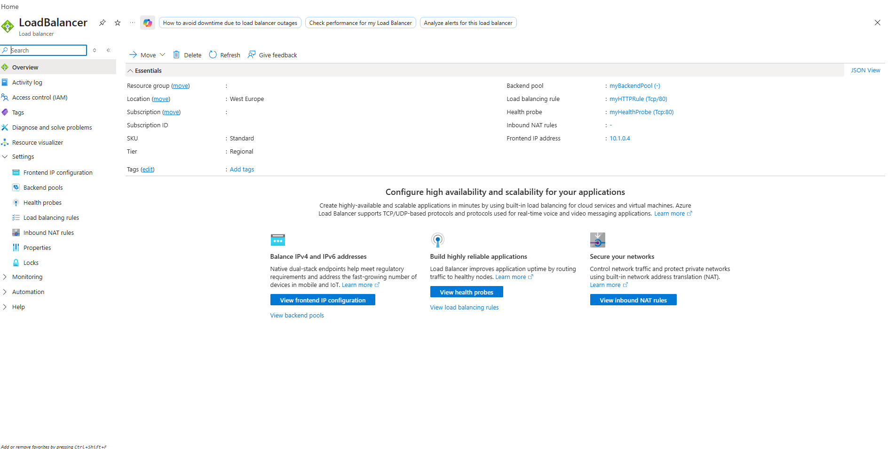
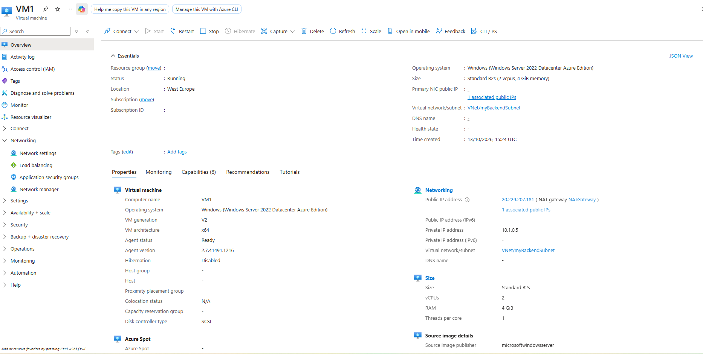
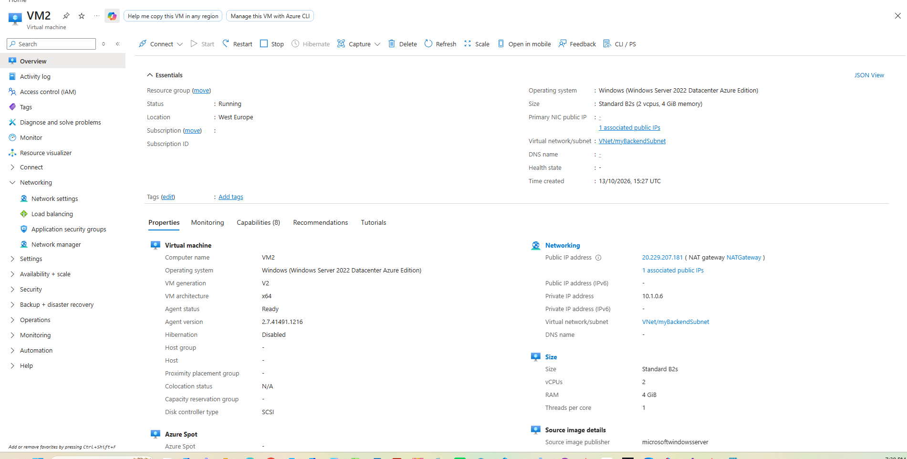
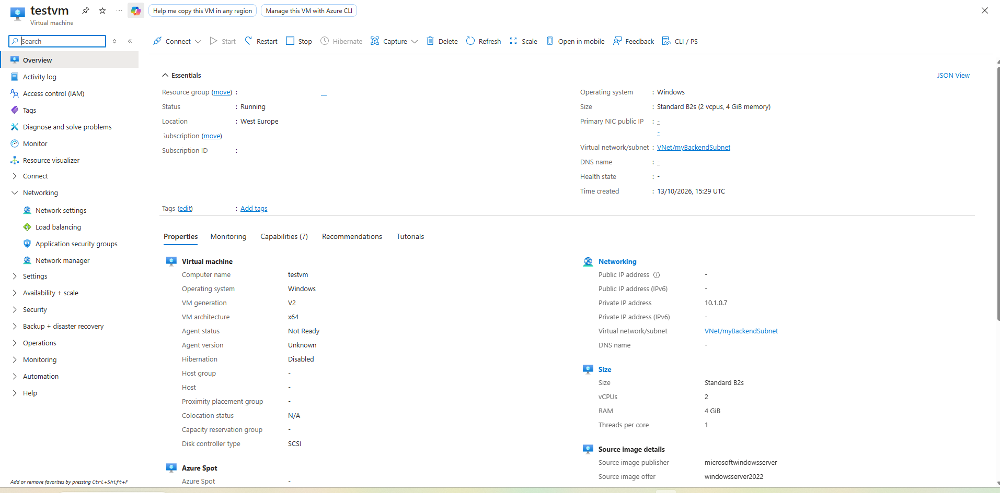
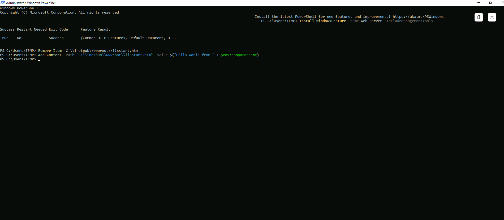
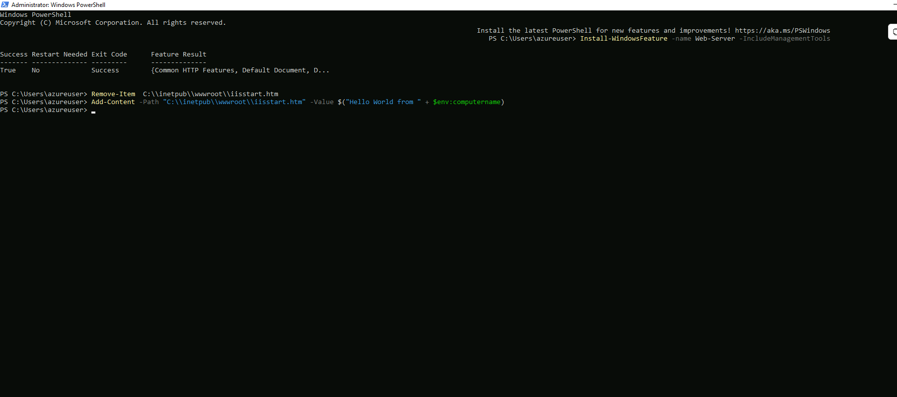
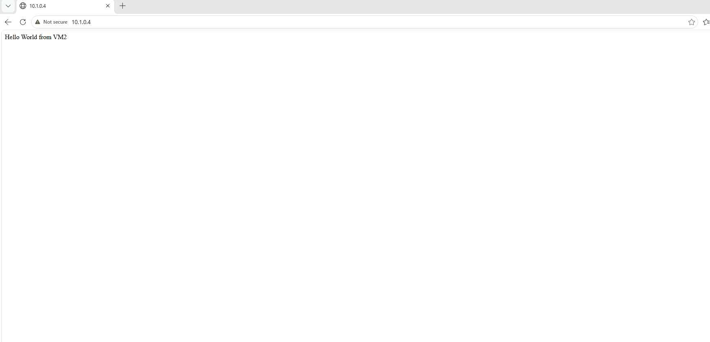

# Deploying and Configuring an Azure Standard Load Balancer with NAT Gateway and Availability Architecture

Comprehensive documentation detailing the deployment of an Azure Load Balancer (`LoadBalancer`), NAT Gateway (`NATGateway`), and backend virtual machines (`VM1` and `VM2`) configured within the West Europe region. The architecture implements secure outbound internet connectivity via NAT Gateway and high-availability Layer 4 traffic distribution.

---

## 1. Architecture & Provisioned Resources

### Core Infrastructure Topology

| Resource Type | Resource Name | Specification / Tier | Region / Location |
| :--- | :--- | :--- | :--- |
| **Load Balancer** | `LoadBalancer` | Standard SKU, Regional | West Europe |
| **NAT Gateway** | `NATGateway` | Standard SKU | West Europe |
| **NAT Public IP** | `NATIP` | Static Standard IPv4 | West Europe |
| **Virtual Network** | `VNet` | Address Space: `10.1.0.0/16` | West Europe |
| **Backend Subnet** | `myBackendSubnet` | Address Prefix: `10.1.0.0/24` | West Europe |
| **Bastion Host** | `VNet-Bastion` | Basic SKU | West Europe |
| **Virtual Machine 1** | `VM1` | Standard B2s, Windows Server 2022 Datacenter | West Europe |
| **Virtual Machine 2** | `VM2` | Standard B2s, Windows Server 2022 Datacenter | West Europe |
| **Test Virtual Machine** | `testvm` | Standard B2s, Windows Server 2022 Datacenter | West Europe |

---

### Provisioned Environment Validation

*Resource group overview confirming successful provisioning of the Load Balancer, NAT Gateway, virtual network, Bastion host, and backend virtual machine instances.*

---

## 2. Step-by-Step Implementation

### Step 1: Inspect Virtual Network Configuration

Reviewed the core virtual network (`VNet`) topology, address space allocations, and subnet configurations supporting backend workloads and management services.

* **Virtual Network:** `VNet`
* **Address Space:** `10.1.0.0/16`
* **Subnet:** `myBackendSubnet` (`10.1.0.0/24`)

*Reviewing essentials and parameters for virtual network VNet.*

---

### Step 2: Configure NAT Gateway for Outbound Connectivity

Provisioned and inspected the NAT Gateway (`NATGateway`) resource attached to the virtual network subnets to ensure secure, scalable outbound SNAT connectivity.

* **NAT Gateway Name:** `NATGateway`
* **SKU:** Standard
* **Public IP:** `NATIP`

*Reviewing NAT Gateway configuration and outbound IP address associations.*

---

### Step 3: Configure Load Balancer Frontends and Backend Pools

Inspected the deployed Standard Load Balancer (`LoadBalancer`) configuration, verifying frontend IP bindings, backend address pools, health probes, and load-balancing rules.

* **Load Balancer Name:** `LoadBalancer`
* **SKU / Tier:** Standard / Regional
* **Frontend IP:** `10.1.0.4`
* **Backend Pool:** `myBackendPool`
* **Load Balancing Rule:** `myHTTPRule` (TCP Port 80)
* **Health Probe:** `myHealthProbe` (TCP Port 80)

*Reviewing Load Balancer essentials, backend pool membership, and routing rules.*

---

### Step 4: Provision and Configure Backend Virtual Machines

Inspected compute and networking properties for the backend virtual machines (`VM1` and `VM2`) to confirm runtime status, private IP allocations, and NAT Gateway integration.

* **Virtual Machine 1:** `VM1` (`10.1.0.5`) bound to `VNet/myBackendSubnet` with NAT Gateway outbound mapping.
* **Virtual Machine 2:** `VM2` (`10.1.0.6`) bound to `VNet/myBackendSubnet` with NAT Gateway outbound mapping.

*Inspecting properties, private/public IP bindings, and network settings for VM1.*

*Inspecting properties, private/public IP bindings, and network settings for VM2.*

---

### Step 5: Provision and Inspect Test Virtual Machine

Reviewed the supplementary test virtual machine (`testvm`) configuration within the backend subnet used for internal connectivity and load balancing validation tests.

* **Computer Name:** `testvm`
* **Subnet:** `VNet/myBackendSubnet` (`10.1.0.7`)
* **Operating System:** Windows Server 2022 Datacenter

*Inspecting properties and network placement for testvm.*

---

### Step 6: Install Web Server Features on Backend Compute Nodes

Executed PowerShell automation scripts on backend instances to install Internet Information Services (IIS) and configure customized landing pages identifying individual nodes.

* **PowerShell Feature Install:** `Install-WindowsFeature -name Web-Server -IncludeManagementTools`
* **Content Customization:** Replaced default placeholder with dynamic host identification strings (`Hello World from VM1` / `Hello World from VM2`).

*Executing PowerShell deployment script and customizing web root content on VM1.*

*Executing PowerShell deployment script and customizing web root content on VM2.*

---

### Step 7: Validate Load Balanced Traffic Distribution

Tested internal HTTP requests routed through the Load Balancer frontend IP (`10.1.0.4`) from test instances to confirm successful Layer 4 traffic distribution across backend compute nodes.

* **Target URL:** `http://10.1.0.4`
* **Validation Result:** HTTP requests successfully load balanced and answered by backend web servers.

*Browser test validating successful response routing from backend compute nodes via Load Balancer.*
